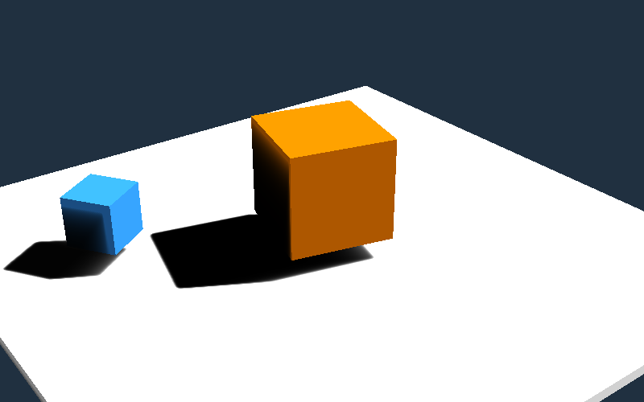

# Utiliser Hide, l'éditeur de Heaps

> Compiler et lancer Hide, créer un niveau avec, charger ce niveau dans un jeu Heaps et ajouter ses propres types de prefab à l'éditeur.

*[English version](../02-hide.md)*



L'exemple de ce guide se trouve dans [`examples/hide`](https://github.com/Jonathan-HETEAU/Heapheapheaps/tree/main/guides/examples/hide) : un petit projet avec son dossier `res/`, un niveau fait de prefabs Hide, un type de prefab du jeu (`Spinner`) et le jeu qui charge le niveau. Les fichiers de l'exemple sont commentés en anglais, comme tout le code du portail ; ce guide traduit les commentaires, le code est le même. Les menus de Hide sont en anglais : le guide garde leurs noms.

## Ce qu'est Hide

Hide (Heaps IDE) est l'éditeur que Shiro Games utilise pour ses jeux. Il travaille sur les fichiers du dossier `res/` d'un jeu : on ouvre le projet, Hide affiche ses ressources, et chaque type de fichier s'ouvre dans son propre éditeur.

| Fichiers | Éditeur | Dans le jeu |
|---|---|---|
| `.prefab` | Éditeur de scène : un arbre d'objets (modèles, lumières, boîtes, vos propres types...) | [`hrt.prefab.Prefab`](../../api/hide/hrt/prefab/Prefab.md) |
| `.l3d` | Le même éditeur de scène, pour des niveaux 3D complets (terrain, éclairage précalculé...) | `hrt.prefab.Prefab` |
| `.fx`, `.fx2d` | Effets visuels sur une timeline : émetteurs, courbes, propriétés animées | [`hrt.prefab.fx.FX`](../../api/hide/hrt/prefab/fx/FX.md) |
| `.shgraph` | Shader graph : un shader fait de nœuds reliés entre eux | [`hrt.shgraph.ShaderGraph`](../../api/hide/hrt/shgraph/ShaderGraph.md) |
| `.matlib`, `.rp` | Bibliothèque de matériaux, profil de rendu | `hrt.prefab.Prefab` |
| `.fbx`, `.hmd` | Visionneuse de modèles : animations, matériaux | `hxd.res.Model` |
| images, `.wav`, `.mp3`, `.ogg` | Visionneuse d'images, lecteur de sons | `hxd.res.Image`, `hxd.res.Sound` |
| `data.cdb` (menu Database) | Tables [CastleDB](https://castledb.org) : les données du jeu | `cdb` |

Hide a deux parties :

- **l'éditeur** (paquet `hide`), une application JavaScript qui tourne dans [NW.js](https://nwjs.io) ;
- **le runtime** (paquet `hrt`), que le jeu utilise avec `-lib hide` pour charger ce que l'éditeur a produit.

La plupart de ces fichiers sont des **prefabs** : un arbre de nœuds typés, enregistré en JSON. Chaque nœud a un type (`"box"`, `"light"`, `"model"`...), qui est une classe Haxe enregistrée sous ce nom, et les champs de cette classe marqués `@:s`. L'éditeur crée et modifie l'arbre, et le jeu reconstruit les mêmes objets à partir de lui.

## Compiler et lancer Hide

Hide se compile depuis ses sources, avec les mêmes bibliothèques que le jeu. Installez-les depuis git, comme l'indique le [README de Hide](https://github.com/HeapsIO/hide#compiling-from-source) :

```sh
haxelib git format https://github.com/HaxeFoundation/format
haxelib git heaps https://github.com/HeapsIO/heaps
haxelib git castle https://github.com/ncannasse/castle
haxelib git hxbit https://github.com/ncannasse/hxbit
haxelib git hscript https://github.com/HaxeFoundation/hscript
haxelib git hxnodejs https://github.com/HaxeFoundation/hxnodejs
haxelib git domkit https://github.com/HeapsIO/domkit
haxelib git hx3compat https://github.com/HaxeFoundation/hx3compat
haxelib git hashlink https://github.com/HaxeFoundation/hashlink master other/haxelib/
```

Clonez ensuite Hide, déclarez-le comme bibliothèque pour vos jeux, et compilez l'éditeur :

```sh
git clone https://github.com/HeapsIO/hide
haxelib dev hide hide
cd hide
haxe hide.hxml          # crée bin/hide.js
```

Hide tourne dans **NW.js** : téléchargez le **SDK** de NW.js sur [nwjs.io](https://nwjs.io) et copiez-le dans `bin/nwjs`. Ensuite :

- Windows : lancez `bin/hide.cmd`.
- Linux : depuis le dossier `bin`, lancez `nwjs/nw .`
- macOS : copiez tous les fichiers de `bin` dans `bin/nwjs.app/Contents/Resources/app.nw`, puis ouvrez l'application NW.js.

Hide et le jeu doivent utiliser le même Heaps : si `haxe hide.hxml` échoue, mettez à jour les bibliothèques depuis git.

## Ouvrir un projet

Un projet Hide est le dossier qui contient le dossier `res/` du jeu. Utilisez **Project > Open...** et choisissez ce dossier (choisir `res/` lui-même marche aussi : Hide remonte d'un dossier). Les derniers projets ouverts sont dans **Project > Recently opened**.

Hide lit ses réglages dans `bin/defaultProps.json`, puis dans vos réglages utilisateur, puis dans le `res/props.json` du projet, chacun remplaçant les précédents ; un `props.json` placé dans un sous-dossier s'applique aux fichiers de ce dossier. Les plugins du jeu se déclarent dans `res/props.json` (voir [Vos propres types de prefab](#vos-propres-types-de-prefab)), un fichier JSON qui se modifie comme les autres. **Settings > User settings** modifie vos préférences, et **Settings > Project settings** liste les fichiers `props.json` du projet et modifie leurs bibliothèques de matériaux, leurs render props et leurs réglages de conversion. La base CastleDB du projet est `res/data.cdb` (réglage `cdb.databaseFile`), et s'ouvre depuis le menu **Database**.

## L'interface

- **Explorateur de fichiers** (**View > File Browser**) : les fichiers de `res/`. Un double-clic ouvre un fichier dans un onglet ; un clic droit sur un dossier, puis **New ...**, crée un fichier (dossier, prefab, FX, shader graph, particules...).
- **Éditeur de scène** (`.prefab`, `.l3d`, `.fx`) : la vue 3D, l'arbre du prefab à côté, et les propriétés du nœud sélectionné. Un clic droit dans l'arbre, puis **New...**, ajoute un nœud ; les types sont rangés par catégorie (**3D**, **2D**...).
- **Onglets** : plusieurs fichiers ouverts à la fois ; **Layout** enregistre la disposition des panneaux.

Se déplacer dans la vue 3D :

| Action | Souris et touches |
|---|---|
| Regarder autour de soi | Maintenir le bouton droit et bouger la souris |
| Voler | En maintenant le bouton droit : Z Q S D ou les flèches (W avance aussi) ; A et E inclinent la vue, Maj + A / E montent et descendent |
| Changer la vitesse de vol | Molette, en maintenant le bouton droit |
| Faire glisser le sol | Maintenir le bouton du milieu (ou Alt + bouton gauche) |
| Cadrer la sélection | F |

Les principaux raccourcis de l'éditeur de scène (ils sont tous dans `bin/defaultProps.json`, clés `key.*`, et se changent dans les réglages) :

| Touche | Action | Touche | Action |
|---|---|---|---|
| W | Gizmo de déplacement | Ctrl+S | Enregistrer |
| E | Gizmo de rotation | Ctrl+Z / Ctrl+Y | Annuler / rétablir |
| R | Gizmo de mise à l'échelle | Ctrl+D | Dupliquer sur place |
| X | Magnétisme activé / désactivé | Suppr | Supprimer |
| G | Grille affichée / masquée | F2 | Renommer |
| H / Ctrl+H | Masquer / tout réafficher | Ctrl+G | Grouper la sélection |
| I | Isoler la sélection | Retour arrière | Sélectionner le parent |

## Créer un niveau

1. Dans l'explorateur de fichiers, faites un clic droit sur `res`, puis **New ...**, **Prefab**, et nommez-le `level` : Hide crée `res/level.prefab` et l'ouvre.
2. Clic droit dans l'arbre, **New...**, **3D**, **Light**. Dans ses propriétés, mettez **Kind** sur **Directional**, et orientez la lumière avec les champs de rotation pour qu'elle éclaire la scène par le dessus.
3. **New...**, **3D**, **Box** : renommez la boîte `ground` (F2), puis donnez-lui une échelle de 12 × 12 × 0.2 et un Z de -1 dans le groupe **Position**.
4. Enregistrez avec Ctrl+S.

Le fichier est le JSON de l'arbre. Seuls les champs qui diffèrent de leur valeur par défaut sont écrits :

```json
{
	"type": "prefab",
	"children": [
		{
			"type": "light",
			"name": "sun",
			"rotationY": 50,
			"rotationZ": 30,
			"kind": "Directional",
			"power": 0.8
		},
		{
			"type": "box",
			"name": "ground",
			"z": -1,
			"scaleX": 12,
			"scaleY": 12,
			"scaleZ": 0.2
		}
	]
}
```

Le [`level.prefab`](../examples/hide/res/level.prefab) de l'exemple contient aussi deux nœuds `spinner`, un type défini par le jeu : voir [Vos propres types de prefab](#vos-propres-types-de-prefab).

## Charger le niveau dans le jeu

Le jeu utilise le runtime de Hide avec `-lib hide`. Avec lui, `hxd.Res` donne une [`hrt.prefab.Resource`](../../api/hide/hrt/prefab/Resource.md) pour chaque fichier `.prefab`, `.fx` ou `.l3d`.

```haxe
class Main extends hxd.App {

	var root : h3d.scene.Object;
	var level : hrt.prefab.Prefab;

	override function init() {
		engine.backgroundColor = 0x203040;
		s3d.camera.pos.set(9, -12, 8);
		s3d.camera.target.set(0, 0, 0);

		root = new h3d.scene.Object(s3d);
		load();

		// Enregistrer le niveau dans Hide le recharge dans le jeu en cours (avec hxd.Res.initLocal).
		hxd.Res.level.watch(load);
	}

	function load() {
		root.removeChildren();
		// load() lit le fichier (une fois, puis en cache) ; make() crée ses objets sous root.
		level = hxd.Res.level.load().make(root);

		// L'arbre des prefabs : chercher un prefab par sa classe, ou tous ceux d'une classe.
		for( s in level.findAll(Spinner) )
			trace('${s.name}: ${s.speed} turns per second');
	}

	static function main() {
		#if hl
		hxd.res.Resource.LIVE_UPDATE = true;
		hxd.Res.initLocal(); // les fichiers de res/ lus sur le disque : ils peuvent changer pendant le jeu
		#else
		hxd.Res.initEmbed(); // les fichiers de res/ intégrés au programme
		#end
		new Main();
	}
}
```

- `load()` renvoie le prefab du fichier, qui sert de modèle : il n'est lu qu'une fois, puis gardé en cache.
- `make(parent)` crée les objets de l'arbre sous `parent` (un `h3d.scene.Object` ou un `h2d.Object`) et renvoie l'instance.
- `find(Class)`, `findAll(Class)` et `getOpt(Class, name)` cherchent dans l'arbre de l'instance. Un prefab [`Object3D`](../../api/hide/hrt/prefab/Object3D.md) donne son objet 3D avec `local3d`.
- `watch(callback)` est appelé quand le fichier change : sur HashLink avec `hxd.Res.initLocal()`, le niveau est reconstruit à chaque enregistrement dans Hide.

Les types de prefab utilisés par les fichiers doivent être **compilés dans le jeu** : un type s'enregistre quand sa classe est compilée, et Haxe ne compile que les classes que le code utilise. Listez-les dans le `.hxml` :

```hxml
-cp src
-lib heaps
-lib hide
-main Main
# Les types de prefab Hide utilisés par les niveaux : chacun s'enregistre quand il est compilé.
hrt.prefab.Light
hrt.prefab.l3d.Box
-js main.js
```

Un nœud dont le type n'est pas compilé est chargé comme un prefab [`hrt.prefab.Unknown`](../../api/hide/hrt/prefab/Unknown.md), sans erreur et sans objet : si une partie d'un niveau manque dans le jeu, vérifiez d'abord cette liste. Sur HashLink, `--macro include("hrt.prefab")` les compile tous ; sur le web, cela échoue, car certains n'existent que sur desktop.

## Vos propres types de prefab

Un jeu ajoute ses propres types de nœuds en héritant d'une classe de prefab. Celui-ci est un cube coloré qui tourne sur lui-même :

```haxe
class Spinner extends hrt.prefab.Object3D {

	/** Tours par seconde. **/
	@:s public var speed : Float = 0.5;

	/** Couleur du cube, en 0xRRGGBB. **/
	@:s public var color : Int = 0xFF8000;

	override function makeObject( parent3d : h3d.scene.Object ) : h3d.scene.Object {
		return new SpinnerMesh(parent3d);
	}

	override function updateInstance( ?propName : String ) {
		super.updateInstance(propName);
		var mesh = cast(local3d, SpinnerMesh);
		mesh.speed = speed;
		mesh.material.color.setColor(color);
	}

	#if editor
	// Seulement dans Hide : le nom et l'icône dans le menu "New...", et le panneau de propriétés.
	override function getHideProps() : hide.prefab.HideProps {
		return { icon : "refresh", name : "Spinner" };
	}

	override function edit( ctx : hide.prefab.EditContext ) {
		super.edit(ctx); // position, rotation, échelle
		var props = new hide.Element('
			<div class="group" name="Spinner">
				<dl>
					<dt>Speed</dt><dd><input type="range" min="0" max="4" field="speed"/></dd>
					<dt>Color</dt><dd><input type="color" field="color"/></dd>
				</dl>
			</div>
		');
		ctx.properties.add(props, this, function(propName) ctx.onChange(this, propName));
	}
	#end

	// "spinner" est le type écrit dans les fichiers de prefab.
	static var _ = hrt.prefab.Prefab.register("spinner", Spinner);
}

/** Le cube d'un `Spinner`, qui tourne autour de son axe Z. **/
class SpinnerMesh extends h3d.scene.Mesh {

	public var speed = 0.;

	public function new( parent ) {
		// Le cube partagé par tous les meshes, de 1 unité de côté et centré.
		super(h3d.prim.Cube.defaultUnitCube(), null, parent);
	}

	override function sync( ctx : h3d.scene.RenderContext ) {
		super.sync(ctx);
		rotate(0, 0, speed * Math.PI * 2 * ctx.elapsedTime);
	}
}
```

- Les champs `@:s` sont enregistrés dans le fichier (quand ils diffèrent de leur valeur par défaut), puis relus au chargement.
- `makeObject` crée l'objet 3D, `updateInstance` lui applique les champs : l'éditeur la rappelle à chaque fois qu'une propriété change.
- `register("spinner", Spinner)` donne au type son nom dans les fichiers.
- La partie `#if editor` n'existe que dans Hide : `getHideProps` nomme le type dans le menu **New...**, `edit` construit le panneau de propriétés. `field="speed"` relie un champ de saisie au champ `speed` de la classe, et `ctx.onChange` met la scène à jour.

Le jeu connaît `Spinner` parce qu'il l'utilise. **Hide**, lui, le connaît grâce à un **plugin** : les classes du jeu, compilées pour l'éditeur. Listez-les dans un module :

```haxe
// HideImports.hx : les classes du jeu que Hide doit connaître.
import Spinner;
```

compilez-les avec `hide.Plugin.init()` :

```hxml
# hide-plugin.hxml
-cp src
-lib hide
-lib hxnodejs
-lib domkit
-lib castle
--macro hide.Plugin.init()
-js hide-plugin.js
-dce no
HideImports
```

et déclarez le plugin dans `res/props.json` (son chemin est relatif à `res/`) :

```json
{
	"plugins": ["../hide-plugin.js"]
}
```

Après `haxe hide-plugin.hxml`, rouvrez le projet dans Hide (ou appuyez sur Ctrl+F5 pour recharger l'éditeur) : **New...**, **3D**, **Spinner** ajoute un cube, et sa vitesse et sa couleur apparaissent dans les propriétés. Recompilez le plugin à chaque modification des classes de prefab.

## L'exemple

[`examples/hide`](https://github.com/Jonathan-HETEAU/Heapheapheaps/tree/main/guides/examples/hide) rassemble tout cela. C'est aussi un projet Hide : ouvrez son dossier avec **Project > Open...** après avoir compilé le plugin.

```sh
cd examples/hide
haxe hide-plugin.hxml   # le plugin, pour Hide
haxe build-js.hxml      # le jeu pour le navigateur : ouvrir index.html via un serveur local
haxe build-hl.hxml      # le jeu pour HashLink : hl main.hl, recharge le niveau quand il est enregistré
```

## Dépannage

| Problème | Cause |
|---|---|
| Un nœud du niveau manque dans le jeu, sans erreur | Son type n'est pas compilé dans le jeu : ajoutez sa classe au `.hxml`. |
| Un type du jeu manque dans le menu **New...** de Hide | Le plugin n'est pas compilé, pas déclaré dans `res/props.json`, ou pas rechargé. |
| `Please add -lib domkit` à la compilation du plugin | Ajoutez `-lib domkit` à `hide-plugin.hxml`. |
| `You cannot access the sys package while targeting js` | `include("hrt.prefab")` sur le web : listez plutôt les types nécessaires. |
| `haxe hide.hxml` échoue | Hide a besoin des mêmes versions, récentes, de Heaps et de ses bibliothèques : mettez-les à jour depuis git. |
